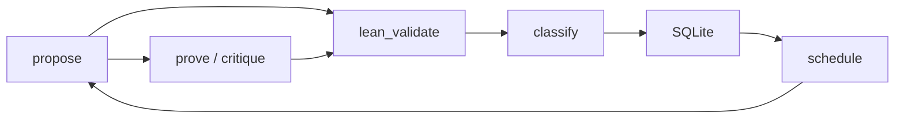

# Continuous loop: generation, Lean, SQLite

> Last updated: 2026-10-12
> Code: `theorem_gen/learn/`. Schema: `docs/continuous-ai-schema.sql` (migrations 001–013, concatenated in that order).

This is the memory of an experiment and a scheduler. In the same process a transformer of about 50 million parameters can train from scratch. `learning: no` stays until a saved champion beats the fixed baseline on held-out and contributes a measurement other than the constant pair `diversity=1` / `resource=1`. A growing row count, or a transformer step, does not do that. The system does not solve an arbitrary hypothesis and does not keep three copies of weights in RAM.

Stages 0–8 remain the base. `python3 -m theorem_gen generate` still produces concrete theorems about `Nat`. The loop does not rewrite them.

## Three roles do not remove hallucinations

`theorem_proposer`, `prover`, and `alternate_prover_critic` can share a backend, a prompt, or copy the same mistake. Agreement among roles is a working signal. `proved` and `refuted` come only from an accepted Lean validation. A role does not write those statuses. The text `"verdict":"proved"` lands in the immutable `attempts.raw_response` and does not enter `derive_outcome`.

## Statuses

A candidate has exactly one `current_status`, recomputed from the `validations` table:

| Status | Source |
|--------|--------|
| `proved` | Lean accepted a complete proof (`sorry` does not pass). |
| `refuted` | Lean accepted the theorem `Not <sentence>` for an instantiated claim. A Python witness does not do this by itself. |
| `unresolved` | No accepted proof and no certificate. Timeout, a failed search, no witness, agreement of roles alone. |
| `ill_formed` | An AST error, or Lean `syntax` / `typing` / a refused construction (`rejected`). |
| `quarantined` | An accepted proof and an accepted counterexample certificate at the same time. That is a system defect, not a fifth mathematical result. `mathematical_outcome` returns `None`. Both validation rows stay. |

Map from `assess_hypothesis`: `invalid_syntax` and `invalid_type` → `ill_formed`. The other three names keep their meaning. Lack of a proof is not falsehood. A compile error is not a counterexample.

A `check` validation (a definition or an expression) that Lean accepted has `result='accepted'` and `accepted=0`. That is neither a proof nor a certificate. The candidate stays `unresolved`, and the row counts as a Lean evaluation. `accepted=1` on type `check` is rejected. Lean's message "is not a proposition" is a typing error, even when "Not a definitional equality" stands beside it. Lean 4.34.1 syntax messages (`unexpected end of input`, `unexpected identifier`, `expected command`, `unexpected token`) are `syntax` and win over `unsolved goals` in the same file. `Unknown identifier` stays class `other`, so the status is `unresolved`.

## Loop



One process. One role slot. Lean checks run in a pool of processes, and writes stay on one thread. Priority goes to whatever unblocks validation, not to a new proposal.

## Modules

| Module | Role |
|--------|------|
| `store.py` | SQLite, migrations, transactions, status derivation. |
| `queue.py` | Queues, leases, heartbeat, backpressure. |
| `checkpoint.py` | Atomic snapshot of the file and the `known_good` row. |
| `classify.py` | Status from validations only. |
| `validate.py` | Adapter over `theorem_gen.verify`. Rejects imports and forbidden constructions before the process starts. |
| `batches.py` | Levels 1–7. Level 1 calls the existing `generate()`. |
| `curriculum.py` | Promotion gate. A training metric is not an input. |
| `roles.py` | Prompts and retrieval of `stable_id` / status / family only. |
| `policy.py` | Baseline, challenger, training corpus. No weight training. |
| `engine.py` | Start, pause, resume, replay. |
| `memory.py` | RSS of this process. The historical measurement had no weights. |
| `minilm.py` | A transformer from scratch, role prefixes, equation samples. |
| `effort.py` | Effort level 1–4 and the Lean time band. |
| `dashboard.py` | A read-only page. |
| `__main__.py` | CLI. |

## SQLite

A file, not `:memory:`. `journal_mode=WAL`, `foreign_keys=ON`, `busy_timeout=5000`. Transactions are `BEGIN IMMEDIATE`. Migration is idempotent: applying the same version again appends nothing.

Tables: `schema_migrations`, `runs`, `candidates`, `attempts`, `validations`, `counterexamples`, `dependencies`, `queue_jobs`, `events`, `curriculum_progress`, `model_versions`, `checkpoints`, `train_items`, `online_weights`, `lm_state`, `model_attempts`, `context_blocks`. Migration 006 created `qlora_state`, and 007 drops it.

`attempts`, `validations`, and `events` have `RAISE(ABORT)` triggers on UPDATE and DELETE. A counterexample certificate can be set once, from `NULL` to a validation id. `idempotency_key` values are unique. A repeated insert returns the existing row.

Only `recompute` rewrites a candidate's status, and only from `validations` rows. Migration 002 forbids inserting a candidate already `proved` or `refuted`. Migration 004 freezes the row's identity (`stable_id`, claim, hash, kind, gate metrics). `current_status` and `updated_at` may change. `accepted=1` requires `result='accepted'` and type `proof` or `counterexample`. `attempt_id` must belong to the same candidate. A counterexample certificate must point at an accepted `counterexample` validation of the same candidate, on both UPDATE and INSERT. An inconsistent `current_status` is rejected on UPDATE.

## Pause, resume, checkpoint

The default interval is 300 s. The allowed range is only 300–600 s. `True` and a floating-point number are rejected.

A checkpoint is written at start, pause, curriculum promotion, model promotion (`Engine.promote_model`), and when the interval elapses. `SIGINT` / `SIGTERM` set a pause request; the loop finishes the step, releases leases, and publishes the pause checkpoint.

The write goes to `seq.json.tmp`, then `os.replace`. The `known_good=1` row enters the database only after the file is replaced. The file carries `attempt_cursor`. A crash before `os.replace` leaves the previous known snapshot and does not publish a new file. A crash after `os.replace` and before the row commit leaves an orphan file; resume takes the previous `known_good`. Resume checks `integrity_check`, that the file hash matches the hash column, and that the LCG, scheduler, event cursor, level, and freeze flag match the file. A column that disagrees with the snapshot is an error. The curriculum level must have recorded gates. `scheduler_committed` events later than the checkpoint cursor advance the batch index and the LCG to the state committed with the proposal, so an older snapshot does not roll back work already stored. Expired or abandoned leases return to `queued`.

If the process dies after `create_run` and before the first checkpoint commits, and there are no jobs or candidates yet, `resume` publishes the start checkpoint and inserts the first proposal. The same happens when a start checkpoint exists and the queue and the candidates are empty: the missing first proposal returns to the queue.

Replay reads a checkpoint, restores the seed, and runs the same steps on a fresh database. A finite budget that keeps adding batches is repeated up to that budget. A `--until-pause` run has no step limit in its configuration; replay of such a run executes one batch from the restored scheduler and does not enter an endless loop. A level above 1 is copied only together with recorded `passed` gates. The replay backend returns `raw_response` for attempts whose `model_version` is not `generator`, and only those inserted after that checkpoint's `attempt_cursor`. It does not call a live model. At level 1 the proposal comes from the generator, so the model call count stays 0. At level 7 the same recorded role answers return to the attempts.

Crash points used in tests: after dequeue and before the lease, after Lean validation and before commit, during the checkpoint write before `os.replace`, and after `os.replace` but before the `known_good` row.

## Queues

| Type | Priority | Worker |
|------|----------|--------|
| `lean_validate` | 100 | Lean |
| `counterexample_search` | 80 | Lean |
| `prove_alternate_or_critique` | 60 | inference |
| `prove_primary` | 50 | inference |
| `propose` | 10 | inference |

The default high-water is 128, counted per type and per run, states `queued` and `leased`. For `lean_validate` the 128 is also per origin: generator and model each have their own unfinished budget. A proposal that does not fit the limit returns the lease, rewinds the LCG and the whole scheduler dictionary (including `last_mix`), and holds only further proposals. Lean work and roles continue. Resume clears that hold. A validation or role error marks that job `failed` and does not stop the next one. `Crash` is not caught as an ordinary error.

When there is work, a step takes both slots that have a queue. Occupancy in the test is a step counter, not a CPU percentage. A step that finished work counts as busy. A step that returned a lease, got `unavailable`, or marked a job `failed` counts as idle. The test threshold is occupancy ≥ 80% when there is something to do.

A proposal error returns the lease and increments `retry_count`. After three tries the job is `failed`, the batch index advances, and the next proposal enters the queue. One bad batch does not stop the run. `Crash` is not caught as an ordinary error.

`lean_validate` can run in parallel. The default is two `lean` processes. SQLite writes stay on one thread. `--lean-workers 1` returns to one check per step. A pause signal does not cut a group that has already started; after it, leases return to the queue. The number of processes changes only the waiting time. The training cursor stands on the first sentence without a verdict and does not skip a later number that is already ready. A training step is the next four `proved` sentences. A shorter piece in front of an open check waits and is not its own step. When that read has nothing new, a replay walks proved rows already behind the cursor, generator and model together, by id. `lm_state.replay_id` is the last id included. A resume continues after it, and the next pass starts at 0 once the walk meets the cursor. A replay step updates the weights and does not enter the loss streak that lets the model write. The limit of 128 unfinished checks is separate for the generator and for the model.

Four queues share this one process. Each proposal takes a batch from the old generator and one `richgen` sentence (an equality with variables, `ac_rfl` or `rw`). In `provenance` the new sentence has `generator: richgen`; the rest of the batch keeps the old names (`generate`, `generate_general`, `wide_ast`). Both have `origin: generator`. The generator (`propose`) and Lean run on their own. The 50M transformer, trained from scratch, takes new `proved` rows past `lm_state.cursor_id`, stopping at the first check still in flight. When 10 losses in a row are under 0.45, the model puts 10 of its own equations into the Lean queue, then returns to study for 200 steps. An empty pile is not the condition. One `<|propose|>` token asks for an equation. If that equation's text is already in the run, the sample is `duplicate` and does not go to Lean. If it is not in the database, the candidate gets `provenance.origin = model` and goes to `lean_validate`. An accepted proof returns to training. Eight weak samples in a row (duplicate, `ill_formed`, `unresolved`) set `lm_hold`: the model stops writing and makes one more pass over the corpus. The generator does not stop during that time. A rising `lm_step` does not set `learning: yes`.

A separate `train_items` table collects `proved` and `refuted` rows that may be used for a weight step. Held-out rows and an excess of descendants of one ancestor (cap 8) stay out. The step updates a small linear vector in `online_weights`. The queue stays in the same file, so pause and `resume` continue it. Those are not the weights of a 7B network. `learning` stays `no` until a champion beats the baseline.

## Curriculum

A new run starts at level 1. `--curriculum` greater than 1 is an error. Levels are not skipped.

| Level | What arrives |
|-------|----------------|
| 1 | `generate()`, concrete `Nat` |
| 2 | `generate_general` |
| 3 | a wide AST, `Nat.succ 0 = 1` |
| 4 | an in-memory registry check |
| 5 | the existing complexity measures, wide bounds |
| 6 | the `double` definition and a theorem about it |
| 7 | three roles, only for `theorem` candidates |

The next batch skips a structural hash this run has already stored. When the numerals 0..9 are exhausted, the same batch raises the numeral cap by 10, up to 79, and keeps depth 2. The default `python3 -m theorem_gen generate` does not change. Otherwise the promotion window would be made of repeats and novelty would stay under 0.5.

From level 2 every proposal adds a review of an earlier range. The review number rotates: at level L the batch of index `batch_index` returns to level `(batch_index % (L - 1)) + 1`. There is at least one candidate and half of `--count`; `build_batch` of that level may add its whole surface. The seed is shifted, and the identifier gets a `review` suffix, so a new row is created. `provenance` has `review: true` and `source_level`. Lean checks these rows the same way as the rest. They do not enter the threshold of 1000 or the promotion windows. The training-corpus choice interleaves them with the current level, by review level, family, outcome, and `ast_size` band.

The size of a numeral is not difficulty. The measures are `ast_size`, `depth`, `variables`, `operators`, `dependencies`, `definitions`.

The gate, all at once:

- at least 1000 candidates of the level evaluated by Lean, outside held-out. Timeouts and a missing toolchain do not count toward that thousand. The number does not grow with the level. Level 2 counts only `generate_general` toward the thousand. Level 3 also requires one evaluated `wide_ast`. Level 6 requires an evaluated `double` definition and a theorem about it. Levels 4 and 5 stay at the thousand alone, because the registry and the measures add no new candidates;
- three successive windows of 100 meet the threshold;
- zero correctness violations (a stored status different from the derived one, or `quarantined`);
- structural novelty does not fall below 0.5 and the window is not trivial (one proof method and median `ast_size` ≤ 2);
- held-out is not worse than this run's baseline;
- at most one promotion per checkpoint window.

A failed gate after reaching 1000 sets `advancement_frozen` and appends an event when the reason is correctness, held-out, or diversity. It does not delete validations. `training_loss` alone in `events` promotes nothing. Below 1000, or without coverage of the level's new capability, the gate is `not_ready`, with no freeze.

Held-out is a pair never used as training: `0 = 0` with `rfl`, and `Not (1 = 0)`. `diversity` and `resource` in the baseline scores are the generator's constants 1.0, not a measurement of the network. While the champion and the baseline both have those constants, `learning_claimed` stays false, even when `solve_rate` is higher. Corpus balance goes by family, outcome, and `ast_size` band.

When the backend raises "live inference is not available", a level 7 proposal stays with the generator text and does not insert role jobs. Lean still evaluates the candidate. A connected model uses the same `ModelSlot`.

From level 7 the roles exchange only SQLite rows. The proposer does not get a chat history, only the AST contract and up to three earlier `proved` / `refuted` rows by family. The prover does not see the proposer's notes beyond the candidate. The alternate in the `prove` phase gets `primary=None`. Critique is a separate job and sees both artifacts. A proof job below level 7 ends `failed` and creates no attempt.

## Memory on a 24 GB Mac

The network in this loop is a transformer from scratch, about 50 million parameters, context 512 tokens. Adam's moment buffers are saved next to the weights in `adam.safetensors`, every 500 training steps and when the process stops. The weights themselves are written every 20 steps. A resume with that file keeps the optimizer. Without it, Adam starts at zero and the next updates are oversized. A sentence that does not fit in that window together with the role mark and `<|end|>` does not enter the weights. A row in `context_blocks` has status `blocked by context limit` and stays until a larger window can hold it. Only then does the model read it. Shorter sentences continue. An empty cursor does not finish epoch 0 while such a row is waiting. The process budget stays 18 GB so Lean and macOS have room. Three resident copies are refused by `ModelSlot`. A 7B model is not loaded.

Roles with no backend still get "live inference is not available" and stay with the generator text. The transformer does not enter those roles: it studies `proved` sentences in fours, and when 10 losses in a row are under 0.45 it proposes 10 equations. An open check holds the step, including when fewer than four accepted sentences sit in front of it. `python3 -m theorem_gen.learn memory` measures the control-plane RSS. The report from before this network: `docs/continuous-ai-memory.md`.

The small vector in `online_weights` is counted separately and is not this network. The transformer's corpus is the same rows that may be used for training: Lean-`proved` with an accepted proof, or `refuted` with a certificate. Held-out is skipped. `adjudicate` compares a challenger with the champion. A regression on any metric, or no strict improvement of `solve_rate`, means `rolled_back`. Otherwise the old champion becomes `retired`.

## Effort and the page

Levels 1–4 describe this fragment, not mathematics in general. `decide` on a small tree is 1. `rfl` is 2, and at `ast_size` ≥ 8 or `depth` ≥ 3 it moves to 3. `lemma` is 3. `rewrite`, `ast_size` ≥ 12, or `depth` ≥ 4 is 4. The size of a literal does not raise the level. `proof_method = model` has no AST tree in `ast_size`, so it gets no such grade.

`validations.lean_ms` is the wall time of one check. Bands: under 100 ms, up to 500 ms, up to 2 s, above. Rows from before migration 008 have `NULL`.

`python3 -m theorem_gen.learn dashboard --run-id RUN` serves `http://127.0.0.1:8765/` and reads the database read-only. It does not run migrations and it is not a second writer. The first cards count own equations Lean accepted, and that count over the ones already judged. The latest sentences are listed with `model_attempts.lm_step` and `loss` from migration 012, stored when the equation was written. A chart plots the accepted share at every judged equation: the last 10, the share from the first, and a Wilson bar for each block of 20. A second bar is the nesting depth of the accepted equations in that block. Depth 1, including a large numeral, is the low band. Depth 2 is the middle band. Depth 3 and above share the top band. Freedom is the latest block of 20, not a memory of earlier blocks. The baseline is 10 equations then 200 study steps, and the weak-try stop is 8. A lower Wilson bound above one half uses 20 equations, 100 study steps, and a weak stop of 12. Above three quarters it is 40, 50, and 16. At or below one half the next block returns to the baseline at once. A depth-credit lower bound above three quarters adds one step only while the share is already above one half. No finished block leaves the baseline in place. How long Lean took is not an input. The 1–4 grade still does not apply to a model row, because that row stores no syntax tree. Migration 013 stores the measurement the chart below the share uses: `expr_depth`, `expr_operators`, and `expr_size`, taken from the equation text at the moment of writing with the same counts as `complexity.py`. NULL means the text is not a statement of this fragment. The depth chart is the mean of accepted equations, last 10 and from the first, and a 95% Student interval on each block of 20. The operator chart is the same population. The table below still compares the last 10 minutes with the 10 before. Rows still waiting for Lean stay out of that share. "New material" counts `proved` sentences the first read has not reached. Replay of sentences already behind the cursor is not in that number. "Model may write" shows the stage: how many recent updates in a row are under 0.45, out of 10, or Yes, Studying, Waiting, or No.

## Lean validation

The toolchain is read from `lean/lean-toolchain` and stored as text and sha256. Each candidate gets its own temporary file. A proof or `check` source must have the hash recorded in a `bound_source` event in the same transaction as the proposal. A different file does not get `accepted`. A counterexample is recomputed from that candidate's assignment and claim; a substituted negation of someone else's sentence does not pass. One bad file marks that job `failed` and does not stop the queue. The result `unavailable` (no `lake`) stores no validation: the job returns to the queue, the run pauses, and the CLI exits with an error. Otherwise the idempotency key would close the candidate forever as `unresolved`. A counterexample is a separate `verify_source` call on `theorem cert_… : Not <claim> := by decide`.

The limits stay in `theorem_gen.verify`: wall clock, `RLIMIT_CPU`, killing the process group, truncating stdout/stderr. `RLIMIT_AS` does not work on this macOS/CPython and is not worked around here. The adapter also rejects `import` and `#eval`, `run_io`, `run_cmd`, `sorry`, `unsafe`, `axiom`, `opaque` before it calls the runner. The list in stage 0–8 `verify.py` did not gain `import`, so the old verdict would not change.

## CLI

From the repository root. Default database: `var/learn.sqlite` (the `var/` directory is in `.gitignore`).

```sh
python3 -m theorem_gen.learn start --run-id RUN --curriculum 1 --db var/learn.sqlite
python3 -m theorem_gen.learn pause --run-id RUN --db var/learn.sqlite
python3 -m theorem_gen.learn resume --run-id RUN --db var/learn.sqlite
python3 -m theorem_gen.learn status --run-id RUN --db var/learn.sqlite
python3 -m theorem_gen.learn replay --run-id RUN --db var/learn.sqlite --from-checkpoint 1
python3 -m theorem_gen.learn memory
```

Extra flags: `--seed`, `--count`, `--max-steps`, `--checkpoint-interval`, `--timeout`, `--until-pause`, `--lean-workers`, `--lm`. The page: `dashboard --port 8765`. Without `--until-pause` and without `--max-steps`, start has a budget of 50 steps and calls Lean. An empty queue inside that budget enqueues the next proposal, so start works through successive batches until the budget ends or a signal arrives. When the limit falls in the middle of a batch, the loop finishes validations already queued and does not open the next batch. `--until-pause` removes the step limit and ends on SIGINT or SIGTERM. `--max-steps 0` only opens the run and the checkpoint, with no validation. That is a smoke path, not a training mode.

`resume` without `--max-steps` adds another 50 steps. A run started with `--until-pause` resumes until the next signal. An explicit `--max-steps` on `resume` limits that resume. Replay from the start checkpoint (`--from-checkpoint 1`) repeats the recorded step budget. A pause checkpoint is a `resume` point. Replay from a pause starts from the LCG saved after the finished batches and gets the next theorems. Reproducing a run starts from the start checkpoint.

`status` prints `learning: yes` or `learning: no`.
