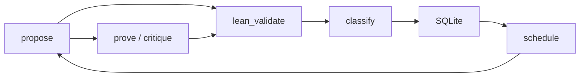

# Ciągła pętla: generowanie, Lean, SQLite

> Ostatnia aktualizacja: 2026-10-11
> Kod: `theorem_gen/learn/`. Schemat: `docs/continuous-ai-schema.sql` (migracje `001_initial.sql`, `002_integrity.sql` i `003_checks.sql`, sklejone w tej kolejności).

To jest pamięć eksperymentu i scheduler, nie wytrenowany model. `learning: no` zostaje, dopóki zapisany champion nie pobije stałego baseline na held-out i nie wniesie pomiaru innego niż para stałych `diversity=1` / `resource=1`. Sam przyrost wierszy w SQLite tego nie robi. System nie rozwiązuje dowolnej hipotezy i nie trzyma trzech kopii wag w RAM.

Etapy 0–8 zostają bazą. `python3 -m theorem_gen generate` nadal produkuje konkretne twierdzenia o `Nat`. Pętla ich nie przepisuje.

## Trzy role nie usuwają halucynacji

`theorem_proposer`, `prover` i `alternate_prover_critic` mogą dzielić backend, prompt albo skopiować ten sam błąd. Zgoda ról jest sygnałem roboczym. Status `proved` albo `refuted` powstaje tylko z zaakceptowanej walidacji Leana. Rola nie zapisuje tych statusów. Tekst `"verdict":"proved"` ląduje w niezmiennym `attempts.raw_response` i nie wchodzi do `derive_outcome`.

## Statusy

Kandydat ma dokładnie jeden `current_status`, liczony od nowa z tabeli `validations`:

| Status | Skąd |
|--------|------|
| `proved` | Lean przyjął kompletny dowód (`sorry` nie przechodzi). |
| `refuted` | Lean przyjął twierdzenie `Not <zdanie>` dla skonkretyzowanej tezy. Świadek z Pythona sam tego nie robi. |
| `unresolved` | Brak przyjętego dowodu i brak certyfikatu. Timeout, porażka szukania, brak świadka, sama zgoda ról. |
| `ill_formed` | Błąd AST albo Lean `syntax` / `typing` / odmowa konstrukcji (`rejected`). |
| `quarantined` | Jednocześnie przyjęty dowód i przyjęty certyfikat kontrprzykładu. To defekt systemu, nie piąty wynik matematyczny. `mathematical_outcome` zwraca `None`. Oba wiersze walidacji zostają. |

Mapa z `assess_hypothesis`: `invalid_syntax` i `invalid_type` → `ill_formed`. Pozostałe trzy nazwy bez zmiany znaczenia. Brak dowodu nie jest fałszem. Błąd kompilacji nie jest kontrprzykładem.

Walidacja `check` (definicja albo wyrażenie), którą Lean przyjął, ma `result='accepted'` i `accepted=0`. To nie jest dowód ani certyfikat. Kandydat zostaje `unresolved`, a wiersz liczy się jako ocena Leana. `accepted=1` na typie `check` jest odrzucane. Komunikat Leana „is not a proposition” jest błędem typowania, także gdy obok stoi „Not a definitional equality”. Komunikaty składni Lean 4.34.1 (`unexpected end of input`, `unexpected identifier`, `expected command`, `unexpected token`) są `syntax` i wygrywają z `unsolved goals` w tym samym pliku. `Unknown identifier` zostaje klasą `other`, więc status to `unresolved`.

## Pętla



Jeden proces. Jeden slot modelu. Na krok co najwyżej jedna praca inferencji i jedna praca Leana. Priorytet ma to, co odblokowuje walidację, nie nowa propozycja.

## Moduły

| Moduł | Rola |
|-------|------|
| `store.py` | SQLite, migracje, transakcje, wyprowadzenie statusu. |
| `queue.py` | Kolejki, dzierżawy, heartbeat, backpressure. |
| `checkpoint.py` | Atomowy snapshot pliku i wiersza `known_good`. |
| `classify.py` | Status wyłącznie z walidacji. |
| `validate.py` | Adapter na `theorem_gen.verify`. Odrzuca import i zakazane konstrukcje zanim wystartuje proces. |
| `batches.py` | Poziomy 1–7. Poziom 1 woła istniejące `generate()`. |
| `curriculum.py` | Bramka promocji. Metryka treningowa nie jest wejściem. |
| `roles.py` | Prompty i retrieval samych `stable_id` / status / rodzina. |
| `policy.py` | Baseline, challenger, korpus treningowy. Bez trenowania wag. |
| `engine.py` | Start, pauza, wznowienie, replay. |
| `memory.py` | RSS tego procesu. Wag 7B tu nie ma. |
| `__main__.py` | CLI. |

## SQLite

Plik, nie `:memory:`. `journal_mode=WAL`, `foreign_keys=ON`, `busy_timeout=5000`. Transakcje to `BEGIN IMMEDIATE`. Migracja jest idempotentna: druga aplikacja tej samej wersji nic nie dopisuje.

Tabele: `schema_migrations`, `runs`, `candidates`, `attempts`, `validations`, `counterexamples`, `dependencies`, `queue_jobs`, `events`, `curriculum_progress`, `model_versions`, `checkpoints`.

`attempts`, `validations` i `events` mają triggery `RAISE(ABORT)` na UPDATE i DELETE. Certyfikat kontrprzykładu można ustawić raz, z `NULL` na identyfikator walidacji. Klucze `idempotency_key` są unikalne. Powtórny insert zwraca istniejący wiersz.

Status kandydata przepisuje tylko `recompute`, i tylko z wierszy `validations`. Migracja 002 nie pozwala wstawić kandydata od razu jako `proved` ani `refuted`. Migracja 004 zamraża tożsamość wiersza (`stable_id`, teza, skrót, rodzaj, metryki bramki). Zmienić wolno `current_status` i `updated_at`. `accepted=1` wymaga `result='accepted'` i typu `proof` albo `counterexample`. `attempt_id` musi należeć do tego samego kandydata. Certyfikat kontrprzykładu musi wskazywać przyjętą walidację `counterexample` tego samego kandydata, zarówno przy UPDATE, jak i przy INSERT. Niespójny `current_status` jest odrzucany przy UPDATE.

## Pauza, wznowienie, checkpoint

Domyślny odstęp to 300 s. Dozwolony zakres to wyłącznie 300–600 s. `True` i liczba zmiennoprzecinkowa są odrzucane.

Checkpoint powstaje przy starcie, pauzie, promocji curriculum, promocji modelu (`Engine.promote_model`) i po upływie interwału. `SIGINT` / `SIGTERM` ustawiają prośbę o pauzę; pętla kończy krok, zwalnia dzierżawy i publikuje checkpoint pauzy.

Zapis: treść do `seq.json.tmp`, potem `os.replace`. Wiersz `known_good=1` wchodzi do bazy dopiero po podmianie pliku. Plik niesie `attempt_cursor`. Crash przed `os.replace` zostawia poprzedni znany snapshot i nie publikuje nowego pliku. Crash po `os.replace`, a przed commitem wiersza, zostawia osierocony plik; wznowienie bierze poprzedni `known_good`. Wznowienie sprawdza `integrity_check`, zgodność skrótu pliku z kolumną skrótu oraz zgodność LCG, schedulera, kursora zdarzeń, poziomu i flagi zamrożenia z treścią tego pliku. Rozjazd kolumny ze snapshotem jest błędem. Poziom curriculum musi mieć zapisane bramki. Zdarzenia `scheduler_committed` późniejsze niż kursor checkpointu dosuwają indeks batcha i LCG do stanu zatwierdzonego razem z propozycją, żeby starszy snapshot nie cofnął już zapisanej pracy. Przedawnione albo porzucone dzierżawy wracają do `queued`.

Jeśli proces umrze po `create_run`, a przed commitem pierwszego checkpointu, i nie ma jeszcze prac ani kandydatów, `resume` publikuje checkpoint startowy i wstawia pierwszą propozycję. To samo dzieje się, gdy checkpoint startowy jest, a kolejka i kandydaci są puste: brakująca pierwsza propozycja wraca do kolejki.

Replay czyta checkpoint, odtwarza ziarno i puszcza te same kroki na świeżej bazie. Skończony budżet z dokładaniem partii jest powtarzany do tego budżetu. Bieg `--until-pause` ma w konfiguracji brak limitu kroków; replay takiego biegu wykonuje jedną partię od przywróconego schedulera i nie wchodzi w pętlę bez końca. Poziom wyższy niż 1 jest kopiowany tylko razem z zapisanymi bramkami `passed`. Backend replay oddaje `raw_response` prób o `model_version` innym niż `generator`, i tylko te wstawione po `attempt_cursor` tego checkpointu. Nie woła żywego modelu. Na poziomie 1 propozycja pochodzi z generatora, więc licznik wywołań modelu zostaje 0. Na poziomie 7 te same zapisane odpowiedzi ról wracają do prób.

Punkty crasha używane w testach: po zdjęciu z kolejki a przed dzierżawą, po walidacji Leana a przed commitem, w trakcie zapisu checkpointu przed `os.replace` oraz po `os.replace`, a przed wierszem `known_good`.

## Kolejki

| Typ | Priorytet | Worker |
|-----|-----------|--------|
| `lean_validate` | 100 | Lean |
| `counterexample_search` | 80 | Lean |
| `prove_alternate_or_critique` | 60 | inferencja |
| `prove_primary` | 50 | inferencja |
| `propose` | 10 | inferencja |

High-water domyślnie 128, liczony per typ i per run, stany `queued` i `leased`. Propozycja, która nie mieści się w limicie, oddaje dzierżawę, cofa LCG i cały słownik schedulera (w tym `last_mix`) i wstrzymuje tylko kolejne propozycje. Prace Leana i role idą dalej. Wznowienie zdejmuje to wstrzymanie. Błąd walidacji albo roli oznacza stan `failed` tej pracy i nie zatrzymuje następnej. `Crash` nie jest łapany jako zwykły błąd.

Gdy jest praca, krok zajmuje oba sloty, które mają kolejkę. Zajętość w teście to licznik kroków, nie procent CPU. Krok, który dokończył pracę, liczy się jako zajęty. Krok, który oddał dzierżawę, dostał `unavailable` albo oznaczył pracę jako `failed`, liczy się jako bezczynny. Próg w teście: zajętość ≥ 80%, kiedy jest co robić.

Błąd propozycji oddaje dzierżawę i zwiększa `retry_count`. Po trzech próbach praca jest `failed`, indeks batcha rośnie i do kolejki wchodzi następna propozycja. Jedna zła partia nie zatrzymuje biegu. `Crash` nie jest łapany jako zwykły błąd.

## Curriculum

Nowy bieg zaczyna się na poziomie 1. `--curriculum` większe niż 1 jest błędem. Poziomy nie przeskakują.

| Poziom | Co dochodzi |
|--------|-------------|
| 1 | `generate()`, konkretne `Nat` |
| 2 | `generate_general` |
| 3 | szeroki AST, `Nat.succ 0 = 1` |
| 4 | sprawdzenie rejestru w pamięci |
| 5 | istniejące miary złożoności, szerokie granice |
| 6 | definicja `double` i twierdzenie o niej |
| 7 | trzy role, tylko dla kandydatów `theorem` |

Wielkość liczebnika nie jest trudnością. Miary to `ast_size`, `depth`, `variables`, `operators`, `dependencies`, `definitions`.

Bramka, wszystkie naraz:

- co najmniej 1000 kandydatów poziomu ocenionych przez Leana, poza held-out. Timeout i brak toolchainu nie wliczają się do tego tysiąca. Liczba nie rośnie z numerem poziomu. Poziom 2 liczy do tego tysiąca tylko `generate_general`. Poziom 3 dodatkowo wymaga jednego ocenionego `wide_ast`. Poziom 6 wymaga ocenionej definicji `double` i twierdzenia o niej. Poziomy 4 i 5 zostają przy samym tysiącu, bo rejestr i miary nie dokładają nowych kandydatów;
- trzy kolejne okna po 100 spełniają próg;
- zero naruszeń poprawności (zapisany status różny od wyprowadzonego, albo `quarantined`);
- nowość strukturalna nie spada poniżej 0.5 i okno nie jest trywialne (jeden sposób dowodu i mediana `ast_size` ≤ 2);
- held-out nie jest gorszy od baseline tego biegu;
- co najwyżej jedna promocja na okno checkpointu.

Nieudana bramka po osiągnięciu 1000 ustawia `advancement_frozen` i dopisuje zdarzenie, gdy powodem jest poprawność, held-out albo różnorodność. Nie kasuje walidacji. Sam `training_loss` w `events` nic nie promuje. Poniżej 1000, albo bez pokrycia nowej zdolności poziomu, bramka jest `not_ready`, bez zamrożenia.

Held-out to para nigdy nie używana jako trening: `0 = 0` z `rfl` oraz `Not (1 = 0)`. `diversity` i `resource` w wynikach baseline są stałymi 1.0 generatora, nie pomiarem sieci. Dopóki champion i baseline mają obie te stałe, `learning_claimed` zostaje fałszem, nawet gdy `solve_rate` jest wyższy. Balans korpusu idzie po rodzinie, wyniku i paśmie `ast_size`.

Role od poziomu 7 wymieniają tylko wiersze SQLite. Proposer nie dostaje historii czatu, tylko kontrakt AST i do trzech wcześniejszych `proved` / `refuted` po rodzinie. Prover nie widzi notatek proposera poza kandydatem. Alternate w fazie `prove` dostaje `primary=None`. Krytyka jest osobnym jobem i widzi oba artefakty. Job dowodu poniżej poziomu 7 kończy się `failed` i nie tworzy próby.

## Pamięć na Macu 24 GB

Jeden lokalny model 7B–8B, 4-bit, kontekst 8K–16K, gdy kiedyś zostanie podłączony. Budżet procesu to 18 GB, żeby zostały Lean i macOS. Trzy rezydentne kopie są odrzucane przez `ModelSlot`. 14B nie jest ładowane.

Dziś backend domyślny rzuca błąd „live inference is not available”. Żadne wagi nie są w procesie. `python3 -m theorem_gen.learn memory` mierzy RSS płaszczyzny sterowania. Raport liczbowy: `docs/continuous-ai-memory.md`.

Uczenie wag, jeśli w ogóle, jest offline między biegami: `select_training_rows` bierze tylko Lean-`proved` z przyjętym dowodem albo `refuted` z `lean_certificate_id`. Pomija held-out, `unresolved`, `ill_formed`, świadka bez certyfikatu i `quarantined`. Potomkowie jednego przodka mają cap 8. `adjudicate` porównuje challengera z championem. Regresja którejkolwiek metryki albo brak ścisłej poprawy `solve_rate` oznacza `rolled_back`. Inaczej stary champion przechodzi w `retired`.

## Walidacja Leana

Toolchain jest czytany z `lean/lean-toolchain` i zapisywany jako tekst oraz sha256. Każdy kandydat dostaje własny plik tymczasowy. Źródło dowodu albo `check` musi mieć skrót zapisany w zdarzeniu `bound_source` w tej samej transakcji co propozycja. Inny plik nie dostaje `accepted`. Kontrprzykład jest liczony od nowa z przypisania i tezy tego kandydata; podstawiona negacja cudzego zdania nie przechodzi. Jeden zły plik oznacza `failed` na tej pracy i nie zatrzymuje kolejki. Wynik `unavailable` (brak `lake`) nie zapisuje walidacji: praca wraca do kolejki, bieg robi pauzę i CLI kończy się błędem. Inaczej klucz idempotencji zamknąłby kandydata na zawsze jako `unresolved`. Kontrprzykład to osobne wywołanie `verify_source` na `theorem cert_… : Not <teza> := by decide`.

Limity zostają w `theorem_gen.verify`: czas ścienny, `RLIMIT_CPU`, zabicie grupy procesów, obcięcie stdout/stderr. `RLIMIT_AS` na tym macOS/CPython nie działa i nie jest tu obchodzony. Adapter dodatkowo odrzuca `import` oraz `#eval`, `run_io`, `run_cmd`, `sorry`, `unsafe`, `axiom`, `opaque`, zanim zawoła runner. Lista w `verify.py` etapów 0–8 nie dostała `import`, żeby stary werdykt się nie zmienił.

## CLI

Z katalogu repozytorium. Baza domyślna: `var/learn.sqlite` (katalog `var/` jest w `.gitignore`).

```sh
python3 -m theorem_gen.learn start --run-id RUN --curriculum 1 --db var/learn.sqlite
python3 -m theorem_gen.learn pause --run-id RUN --db var/learn.sqlite
python3 -m theorem_gen.learn resume --run-id RUN --db var/learn.sqlite
python3 -m theorem_gen.learn status --run-id RUN --db var/learn.sqlite
python3 -m theorem_gen.learn replay --run-id RUN --db var/learn.sqlite --from-checkpoint 1
python3 -m theorem_gen.learn memory
```

Dodatkowe flagi: `--seed`, `--count`, `--max-steps`, `--checkpoint-interval`, `--timeout`, `--until-pause`. Bez `--until-pause` i bez `--max-steps` start ma budżet 50 kroków i woła Leana. Pusta kolejka w tym budżecie dostawia następną propozycję, więc start przerabia kolejne partie, aż skończy się budżet albo przyjdzie sygnał. Gdy limit wypada w środku partii, pętla kończy już zakolejkowane walidacje i nie otwiera następnej partii. `--until-pause` zdejmuje limit kroków i kończy się na SIGINT albo SIGTERM. `--max-steps 0` tylko otwiera bieg i checkpoint, bez walidacji. To ścieżka dymna, nie tryb nauki.

`resume` bez `--max-steps` dokłada kolejne 50 kroków. Bieg założony z `--until-pause` wznawia się do następnego sygnału. Jawne `--max-steps` na `resume` ogranicza to wznowienie. Replay z checkpointu startu (`--from-checkpoint 1`) powtarza zapisany budżet kroków. Checkpoint pauzy jest punktem `resume`. Replay od pauzy startuje z LCG zapisanym po zakończonych partiach i dostaje kolejne twierdzenia. Odtworzenie biegu idzie od checkpointu startu.

`status` drukuje `learning: yes` albo `learning: no`.
