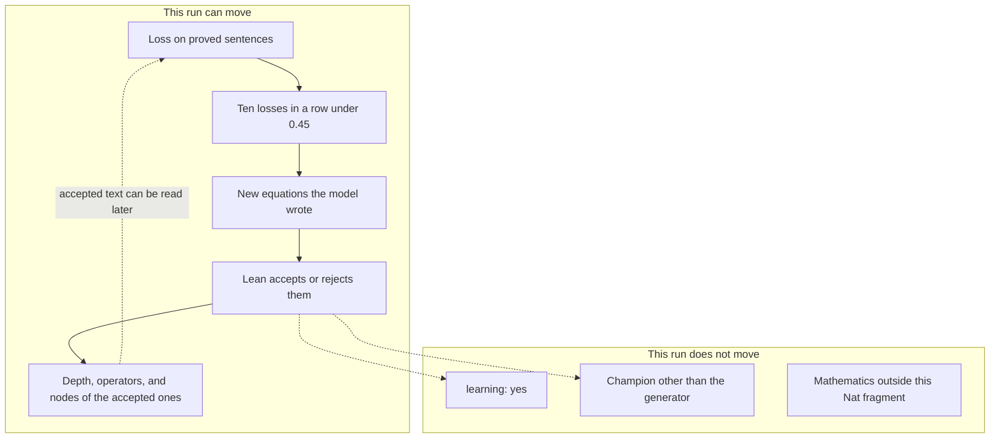
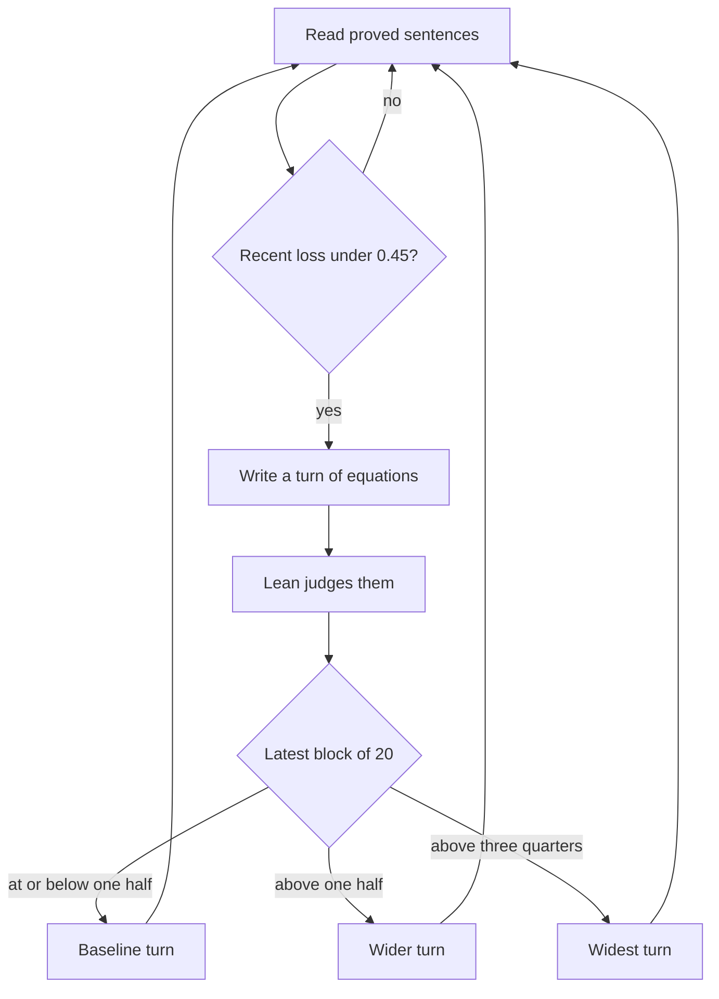

# What this run can show

> Written 2026-10-12, while `run-1` was in progress.
> This note is a reading of the loop as it is wired. It is not a result.

The experiment makes sense. It does not test the wide sentence in the first line of the README, "a model that keeps developing forever." It tests a much smaller machine, and a negative answer from that machine is still a result.

## The question that is actually open

A transformer of about 50 million parameters, with no pretrained weights, reads only sentences Lean has already accepted. When its recent loss is low enough, it writes equations of its own. Lean accepts or rejects them. Accepted ones can be read later. Rejected ones never enter the weights.

The readable outcomes are:

- whether loss on the proved corpus falls through the writing gate, and whether it stays there after the corpus gets richer
- whether sentences the model writes are new, and whether Lean accepts them
- whether the accepted ones get deeper, in the same syntactic sense as the generator, or stay bare equalities

`learning: yes` is not one of those outcomes. The champion is still `champion-generator-v0`. The held-out pair is `0 = 0` and the negation of `1 = 0`, already scored 1.0, and `diversity` and `resource` are the constants 1. The 50M transformer never becomes a challenger. A good run of its own equations does not flip that flag. A bad run does not flip it either.

## Where the run is

Snapshot taken while the process was running, so the next minute changes the counters. Epoch 0. No model equation has been written. `model_attempts` is empty. Freedom is the baseline, because there is no block of 20 judged equations.

| | |
|---|---|
| Training step | about 26,400 |
| Cursor | about 109,000 |
| Last losses | near 0.6, after a fall from about 3.4 at step 20 |
| Proved sentences still unread before the first `richgen` row | about 22,500 |
| First `richgen` id | 131,606 |
| Curriculum lesson | 7 |
| Champion | `champion-generator-v0` |

What the model has read is mostly `rfl`, then `lemma` and `decide`, and a few thousand `rewrite` proofs. What is still ahead, before the richer generator, is again mostly `rfl`. The `ac_rfl` proofs have not been read yet. Loss fell a long way on the easy prefix and then sat near 0.6. Sitting near 0.6 is not the same thing as being about to cross 0.45.

## What a result can mean

**Loss crosses 0.45 and stays under it for ten steps.** The writing gate opens. That says the network has become locally sure of the next token on the sentences it has just read. It does not say the network understands arithmetic. The gate is an operational rule. Cross-entropy can fall because the text is repetitive: a theorem header, `:= rfl`, small numerals.

**Loss stays near 0.6 after the cursor has read thousands of `richgen` proofs.** That is a result about this network on this corpus. The early drop did not continue into the richer proofs. It is not a result about every transformer, and it is not a refutation of "a model can keep improving" in the abstract. It is a reason to stop expecting this run to start writing soon.

**The model writes, and Lean accepts new sentences.** The share of accepted equations, in blocks of 20, is the first number that matches the hope in the README. A block whose lower Wilson bound is above one half is the run's own idea of "clearly not a coin toss." Above three quarters is the run's idea of "clearly strong." Depth, operator count, and node count say whether those accepted sentences are bare `0 = 0` or nested expressions. A large numeral is not depth.

**The model writes, and almost everything is a repeat or a rejection.** That is a negative result with a specific shape. The network learned the surface of the corpus well enough to emit it, and not well enough to leave it. Freedom then stays at the baseline, which is what an average block is supposed to do. The charts are the record. The freedom card is only the thermostat.

**Accepted share rises, then falls.** The share chart is there so that pattern stays visible. One good block of 20 does not establish a trend. The freedom rule already treats the latest block as the whole decision and returns an average block to 10 equations and 200 study steps.

## What it cannot prove

It cannot prove that a language model will improve without a fixed end. The corpus is one fragment: concrete `Nat` theorems from the generator, plus equalities with variables and short `ac_rfl` proofs. Curriculum lesson 7 is the top of that fragment, not the top of mathematics.

It cannot prove that a lower loss is mathematical progress. Rejected text is kept out of the weights, which is the right filter, and the filter is not a theory of understanding.

It cannot prove that its own equations are better than a cheap alternative. There is no second writer that samples typed `rfl` statements at random, and no frozen copy of the network. An accepted share has to be read against the duplicate rate and against the depth of the sentences the model just read. Those are on the page. They are not a controlled experiment.

It cannot show proof skill that the sampler does not ask for. A sample starts from `<|propose|>`. If the completion has no `:=`, the loop appends `:= rfl` and sends that to Lean. A nested true equation proved by `rfl` counts. A `rewrite` or `ac_rfl` proof counts only when the model itself writes the proof text. Early accepts, if they come, will mostly be definitional equalities.

It cannot use elapsed Lean time as difficulty. That number moves with the machine. The shape columns do not.

The network has no position vector. Token order enters through the causal mask only. That is enough for a short equation. It is a real limit once proofs become a list of tactics.

One seed, one width, one run. A single curve cannot separate "this hypothesis is false" from "this network was too small" or "the 0.45 gate was the wrong door."

## How long it is worth leaving on

Three stops, in order. Later ones are only informative if the earlier one happened.

1. **Through the first rich proofs, and a few thousand steps after them.** About 22,500 proved sentences of the old generator are still unread before id 131,606. A training step reads four of them, so that prefix is on the order of 5,600 steps. At the recent pace of this process that is hours, not days, and new rows do not delay it: they are inserted after the rich proofs, not in front of the cursor. The thing to write down is the loss before that id and the loss after a few thousand rich sentences have been read. If the loss jumps and then comes back down, the jump was the change of corpus. If it jumps and sits there, say so, and do not wait for 0.45 out of habit.

2. **If the gate opens, until 200 judged equations.** That is ten blocks of 20. Two blocks only show that the rule can return to baseline. Ten blocks show whether the accepted share and the depth are drifting rather than flickering. One turn at the baseline is 10 equations and then 200 study steps, so 200 judged equations are many turns, not an afternoon, once Lean is checking new text instead of rejecting repeats. If the first ten blocks are almost all repeats and rejections, that negative result is complete enough to stop. If the share or the depth is still moving, keep the same run. Do not start a second one.

3. **Do not run it in order to flip `learning: yes`.** This wiring cannot do that. Stopping because the flag is still `no` throws away the only results the run can produce.

Pausing with SIGTERM is not stopping the experiment. The cursor, the weights, and Adam's moments are meant to continue. A gap of days is fine. Resetting `var/learn.sqlite` or the weight files ends the run and starts a different one.

## What to keep when the run is interpreted

The note to write later is short: the loss curve up to the first rich proofs and after them, the number of judged model equations, the accepted share by block, and the mean depth and operator count of the accepted ones. Freedom is the policy that spent the turns. It is not the measurement. The measurement is already the columns `expr_depth`, `expr_operators`, and `expr_size` on `model_attempts`, together with `lm_step` and `loss` from the moment of writing.
